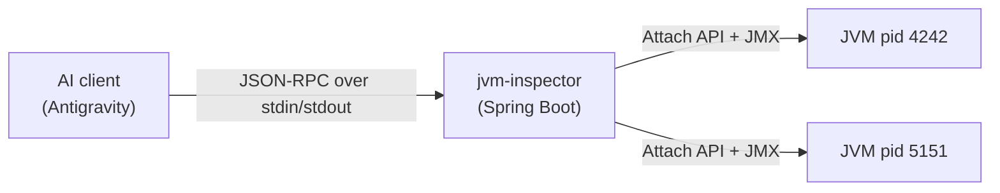

# JVM Inspector — MCP Server

An [MCP](https://modelcontextprotocol.io) server, built with **Java 25 + Spring Boot 4.1 + Spring AI 2.0**, that lets
AI assistants (Antigravity, Claude Desktop, ...) inspect the Java processes running on your machine.

Ask your assistant things like:

> *"Which Java apps are running? Is any of them close to running out of memory?"*
> *"My Spring Boot app is eating CPU, find out why."*
> *"Check pid 4242 for deadlocks."*

## Tools

| Tool | What it does | CLI equivalent |
|---|---|---|
| `list_jvms` | Discover local JVMs (pid + main class) | `jps -l` |
| `jvm_overview` | Java version, uptime, JVM args, CPUs, thread/class counts | `jcmd <pid> VM.info` |
| `heap_usage` | Heap / non-heap and every memory pool | `jstat -gc` |
| `gc_stats` | Collectors, collection counts, % of time in GC | `jstat -gcutil` |
| `thread_dump` | Full thread dump, filterable by state | `jstack` |
| `find_deadlocks` | Detect deadlocked threads | `jstack` (bottom section) |
| `hot_threads` | Threads burning CPU *right now* (sampled) | `top -H` + `jstack` |
| `system_properties` | System properties, filterable | `jcmd <pid> VM.system_properties` |

Prompt: **`diagnose_jvm(pid)`** — a ready-made step-by-step health check that chains the tools above.

All tools are **read-only** (annotated with `readOnlyHint`).

## How it works



1. The AI client **launches the jar as a subprocess** and talks MCP over **STDIO**.
2. Spring AI scans beans for `@McpTool` / `@McpPrompt` methods and exposes them, generating the JSON schema
   from the method signature + `@McpToolParam` descriptions.
3. Each call attaches to the target JVM with the **Attach API** (`jdk.attach`, what `jps`/`jcmd` use), starts its
   local JMX agent and reads the platform **MXBeans** (`MemoryMXBean`, `ThreadMXBean`, ...).

### Code layout

```
src/main/java/dev/dguzman/jvminspector/
├── JvmInspectorApplication.java   # Spring Boot entry point
├── jvm/                           # Pure Java: no MCP knowledge, easy to test
│   ├── JvmConnector.java          # Attach API + JMX connection handling
│   ├── JvmInspector.java          # Reads MXBeans, returns records
│   ├── JvmDescriptor.java
│   └── JvmInspectionException.java
└── mcp/
    └── JvmInspectorTools.java     # @McpTool / @McpPrompt adapter layer
```

> **STDIO golden rule:** stdout *is* the protocol channel. Never `System.out.println` in this app; the banner and
> console logging are disabled in `application.properties`. Logs go to `${java.io.tmpdir}/jvm-inspector-mcp.log`.

## Build & test

```bash
./mvnw package            # compiles, runs unit tests, produces target/jvm-inspector-mcp.jar
```

End-to-end smoke test speaking raw MCP to the jar (handy to see the protocol messages):

```bash
python3 scripts/smoke_test.py target/jvm-inspector-mcp.jar <pid-of-some-jvm>
```

You can also explore it interactively with the official MCP Inspector (needs Node.js):

```bash
npx @modelcontextprotocol/inspector java -jar target/jvm-inspector-mcp.jar
```

## Connect it to an AI client

Use **absolute paths** — the client does not start the process from this folder or with your shell's `PATH`.

### Antigravity

Add to `~/.gemini/config/mcp_config.json` (or via *… > MCP Servers* in the UI):

```json
{
  "mcpServers": {
    "jvm-inspector": {
      "command": "/Users/david.guzman/.sdkman/candidates/java/current/bin/java",
      "args": ["-jar", "/Users/david.guzman/Documents/projects/mcp-server/target/jvm-inspector-mcp.jar"]
    }
  }
}
```

### Claude Desktop

Same JSON block in `~/Library/Application Support/Claude/claude_desktop_config.json`.

## Limitations

- Only JVMs owned by the **same OS user** can be attached to.
- JVMs started with `-XX:+DisableAttachMechanism` are not inspectable.
- Attaching starts the target's local JMX agent (listens only on localhost); it stays active until that JVM exits.

## Ideas for next steps

- `heap_histogram` tool (top classes by instance count/size, like `jmap -histo`) via the `DiagnosticCommand` MBean.
- Expose JVMs as MCP **resources** (`jvm://{pid}/overview`).
- Switch to Streamable HTTP transport (`spring-ai-starter-mcp-server-webmvc`) to inspect JVMs on a remote host.
- Port one tool to Python with FastMCP to compare SDKs.

