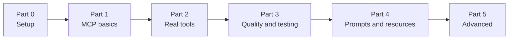

# Learning plan — Build an MCP server in Java

**Project:** JVM Inspector — an MCP server that lets AI assistants inspect Java processes running locally.
**Stack:** Java 25 · Spring Boot 4.1 · Spring AI 2.0 (MCP) · Maven wrapper.
**Learner:** expert in Java, junior in Python, new to MCP.

Each step has: 🎯 goal · 📚 concepts · 🛠️ tasks · ✅ done when · 🛑 checkpoint.
Steps are small on purpose. Agent behaviour rules are in [`AGENTS.md`](../AGENTS.md); progress is tracked in
[`PROGRESS.md`](PROGRESS.md).



---

## Part 0 — Setup

### Step 0 — Preserve the reference solution and start from a skeleton
🎯 Keep the finished implementation as a reference, and give David a clean starting point.

🛠️ Tasks (the **agent** does this step, after David confirms):
1. Make sure the working tree builds: `./mvnw package`.
2. Commit everything currently in the repo on a new branch **`reference-solution`**
   (message: `chore: reference implementation`). Push nothing.
3. Back on `main`, keep only: `pom.xml`, `mvnw`, `mvnw.cmd`, `.mvn/`, `.gitignore`, `AGENTS.md`, `docs/`,
   `scripts/smoke_test.py`, and a minimal `JvmInspectorApplication.java` + an **empty** `application.properties`.
   Delete the `jvm/` and `mcp/` packages and the tests. Replace `README.md` with a 3-line placeholder
   (David will write the real one in Step 13).
4. Commit on `main`: `chore: learning skeleton`.

✅ Done when: `git branch` shows both branches, `main` contains the skeleton, `./mvnw package` succeeds.
🛑 Checkpoint: show David the two branches and how to peek at the reference (`git show reference-solution:<path>`).

---

## Part 1 — MCP fundamentals

### Step 1 — What is MCP? (theory, no code)
🎯 Build the mental model before writing code.

📚 Concepts the agent explains (with a diagram and short examples):
- **Host / client / server**: Antigravity is the *host*, it runs one MCP *client* per configured *server*.
- **JSON-RPC 2.0** messages: request / response / notification.
- **Lifecycle**: `initialize` → `notifications/initialized` → normal operation → shutdown.
- **Capability negotiation**: server announces `tools`, `resources`, `prompts`, `logging`, ...
- **The three building blocks**, and *who controls them*:
  - **Tools**: the model decides when to call them (actions/queries).
  - **Resources**: the application/user picks them (read-only context, addressed by URI).
  - **Prompts**: the user picks them (reusable templates, often slash commands).
- **Transports**: STDIO (a local subprocess) vs Streamable HTTP (remote).
- Why the tool **description** is effectively a prompt for the LLM.

🛠️ Tasks for David:
1. Run the reference server and the smoke test to see real traffic:
   ```bash
   git worktree add ../mcp-server-reference reference-solution
   (cd ../mcp-server-reference && ./mvnw -q package -DskipTests)
   python3 scripts/smoke_test.py ../mcp-server-reference/target/jvm-inspector-mcp.jar <pid from `jps`>
   ```
2. Read `scripts/smoke_test.py` (~50 lines of Python). The agent explains it line by line (David is junior in
   Python), focusing on how it frames JSON-RPC over stdin/stdout.

✅ Done when: David can explain, in his own words, the lifecycle and the difference between tools, resources and
prompts.
🛑 Checkpoint: the agent asks 3–4 quiz questions (e.g. "Who decides when a tool is called?", "Why can't you print to
stdout in a STDIO server?").

### Step 2 — Hello MCP: the smallest possible server
🎯 A Spring Boot app that speaks MCP over STDIO and exposes one trivial tool.

📚 Concepts: Spring AI MCP starter auto-configuration, annotation scanning, sync vs async server, server identity
(`name`, `version`, `instructions`).

🛠️ Tasks for David:
1. Configure `application.properties` for STDIO (see "STDIO hygiene" in `AGENTS.md` — but first, try to figure out
   *why* each property is needed).
2. Create a `@Component` with one `@McpTool` named `ping` that returns `"pong"` plus the server time.
3. Build and call it with `scripts/smoke_test.py` (the agent helps David adapt the script, or add a `--tool` flag).
4. **Break it on purpose**: add a `System.out.println` in the tool, rebuild, and watch the client fail. Then remove it.
5. (Optional, needs Node.js) Explore it with the MCP Inspector:
   `npx @modelcontextprotocol/inspector java -jar target/jvm-inspector-mcp.jar`

✅ Done when: `tools/list` shows `ping` and `tools/call` returns the result.
🛑 Checkpoint: the agent shows the JSON schema Spring AI generated for the tool and asks David where each field came
from.

### Step 3 — Tool parameters and JSON Schema
🎯 Understand how Java method signatures become tool input schemas.

📚 Concepts: `@McpToolParam(description, required)`, primitive vs wrapper types (optional params must be nullable),
how the LLM sees the schema, input validation.

🛠️ Tasks for David:
1. Add an `echo(String message, Integer times)` tool where `times` is optional (default 1, max 10).
2. Inspect the `inputSchema` in `tools/list`. Compare `int` vs `Integer` and `required = true/false`.
3. Send invalid input (missing `message`, `times = -5`) and observe how errors come back
   (`isError: true` in the result vs a JSON-RPC protocol error).

✅ Done when: David can predict the schema of a method before looking at it.
🛑 Checkpoint: delete `ping`/`echo` (or keep them in a `playground` package) before moving on — David decides.

---

## Part 2 — Real tools: inspecting JVMs

### Step 4 — `list_jvms`: discovering JVMs with the Attach API
🎯 First real tool.

📚 Concepts: `com.sun.tools.attach.VirtualMachine.list()` (module `jdk.attach`, what `jps` uses), returning Java
**records** (serialized to JSON automatically), writing a good tool description.

🛠️ Tasks for David:
1. Create the package layout: `jvm/` (pure Java, no MCP imports) and `mcp/` (the `@McpTool` adapter). The agent
   explains why this separation helps testing and reuse.
2. Implement a `JvmDescriptor` record (pid, displayName, self flag) and the `list_jvms` tool.
3. Run it. Notice that some display names are huge (IDE/language-server JVMs) — decide how to handle that and why
   output size matters for an LLM's context window.

✅ Done when: `list_jvms` returns the same JVMs as `jps -l`.

### Step 5 — Connecting to a JVM: Attach + JMX, and `jvm_overview`
🎯 Read data from another JVM.

📚 Concepts: `VirtualMachine.attach(pid)` → `startLocalManagementAgent()` → `JMXConnectorFactory.connect(...)` →
`MBeanServerConnection`; platform MXBeans (`RuntimeMXBean`, `OperatingSystemMXBean`, `ThreadMXBean`,
`ClassLoadingMXBean`) via `ManagementFactory.getPlatformMXBean(connection, Type.class)`; resource cleanup
(`detach`, closing the connector); the self-attach restriction.

🛠️ Tasks for David:
1. Write a `JvmConnector` with a method like `<T> T withConnection(long pid, Callback<T> cb)` that always cleans up.
2. Implement `jvm_overview(pid)` returning a record: Java version, vendor, uptime, JVM arguments, CPUs, load,
   thread and class counts.
3. Test it against a second JVM you start yourself (e.g. `jshell` or any Spring Boot app).

✅ Done when: `jvm_overview` works against another JVM **and** against the server's own pid.
🛑 Checkpoint: discuss the design choice "connect per call" vs "cache connections" — trade-offs?

### Step 6 — Errors the LLM can act on
🎯 Make failures useful to the model.

📚 Concepts: tool execution errors (`isError: true`, the message is read by the LLM) vs protocol errors; writing error
messages that tell the model *what to do next*.

🛠️ Tasks for David:
1. Call `jvm_overview` with a non-existent pid and look at the raw result.
2. Introduce a `JvmInspectionException` and translate `AttachNotSupportedException` / `IOException` into messages
   like "…the process may have exited or belong to another user. Use list_jvms to see attachable JVMs."

✅ Done when: every failure returns a clear, actionable message instead of a stack trace.

### Step 7 — Memory and GC: `heap_usage` and `gc_stats`
🎯 More tools, practicing structured output.

📚 Concepts: `MemoryMXBean`, `MemoryPoolMXBean`, `GarbageCollectorMXBean`; designing output for an LLM
(human-readable units like "37.1 MB", percentages, avoid noise); tool annotations
(`@McpTool.McpAnnotations(readOnlyHint = true, openWorldHint = false)`) and what clients do with them.

🛠️ Tasks for David:
1. `heap_usage(pid)`: heap, non-heap and each pool (used/committed/max/% of max).
2. `gc_stats(pid)`: per collector count and time, plus % of uptime spent in GC.
3. Add read-only annotations to all tools so far.

✅ Done when: both tools work and their output is understandable at a glance.

### Step 8 — Threads: `thread_dump` and `find_deadlocks`
🎯 Text output and output-size control.

📚 Concepts: `ThreadMXBean.dumpAllThreads`, `findDeadlockedThreads`; why `ThreadInfo.toString()` truncates to 8
frames; returning plain text vs JSON; limiting output (filters, max frames) to protect the context window.

🛠️ Tasks for David:
1. `thread_dump(pid, state?, maxFrames?)` returning text similar to `jstack`.
2. `find_deadlocks(pid)`.
3. Write a tiny Java program that deadlocks on purpose and check the tool finds it.

✅ Done when: the deadlock is detected and the dump is readable.

### Step 9 — `hot_threads` and `system_properties`
🎯 A tool with real logic: sampling.

📚 Concepts: per-thread CPU time (`getThreadCpuTime`), taking two samples and computing deltas, long-running tool
calls (how long is acceptable?), parameter limits (cap `sampleMillis`).

🛠️ Tasks for David:
1. `hot_threads(pid, sampleMillis?, limit?)` → top threads by CPU % during the window.
2. `system_properties(pid, filter?)`.
3. Verify with a program that has a busy-spinning thread.

✅ Done when: the busy thread shows up at ~100% CPU.
🛑 Checkpoint: Part 2 retrospective — David summarises which tools exist and what he would change.

---

## Part 3 — Quality, testing, and real usage

### Step 10 — Unit tests
🎯 Test the `jvm/` layer without MCP.

📚 Concepts: testing against the test JVM itself (self-inspection via platform MBean server); creating deadlocks and
busy threads inside tests; daemon threads for cleanup.

🛠️ Tasks for David: JUnit 5 + AssertJ tests for each inspection, including a deadlock test and a hot-thread test.

✅ Done when: `./mvnw package` runs the tests green.

### Step 11 — Integration test with a Java MCP client
🎯 Test the server end-to-end *in Java*, the way a real client would — and learn the client side of MCP.

📚 Concepts: the MCP Java SDK client (`McpClient.sync(...)` with a STDIO client transport that launches the jar);
`initialize`, `listTools`, `callTool`; the `maven-failsafe-plugin` for `*IT` tests that need the packaged jar.
(The agent must verify the exact client class names in `mcp-core-2.1.0.jar` before suggesting code.)

🛠️ Tasks for David: write `McpServerIT` that starts the jar, checks all tools are listed, and calls `list_jvms`.

✅ Done when: `./mvnw verify` runs the integration test green.

### Step 12 — Connect to Antigravity and tune descriptions
🎯 Use the server with a real AI assistant and learn from how the model uses it.

🛠️ Tasks for David:
1. Add the server to `~/.gemini/config/mcp_config.json` (absolute paths to `java` and the jar).
2. Check it appears under *… > MCP Servers*.
3. Ask real questions: "Which Java apps are running?", "Is any of them under memory pressure?", "Why is my app
   using CPU?". Watch which tools the model calls, in what order, and where it gets confused.
4. Improve at least two tool descriptions based on what you observed, and re-test.

✅ Done when: the assistant answers a diagnostic question correctly using several tools in a row.
🛑 Checkpoint: David writes down 2–3 lessons about "designing tools for LLMs".

### Step 13 — README
🎯 Document the project in David's own words (tools table, architecture diagram, how to build/connect, limitations).

---

## Part 4 — The other MCP building blocks

### Step 14 — Prompts: `diagnose_jvm`
🎯 Learn MCP prompts.

📚 Concepts: `@McpPrompt` + `@McpArg`; `prompts/list` / `prompts/get`; message roles; prompts appear as user-selectable
templates (slash commands) in clients. Gotcha: returning `String` produces an *assistant* message — return a
`GetPromptResult` with `Role.USER`.

🛠️ Tasks for David: a `diagnose_jvm(pid)` prompt that guides the model through overview → heap → GC → hot threads →
deadlocks → report. Try it from Antigravity.

✅ Done when: `prompts/get` returns a user-role message and the prompt works in the client.

### Step 15 — Resources: `jvm://{pid}/overview`
🎯 Learn MCP resources and resource templates.

📚 Concepts: resources vs tools (application-controlled context vs model-invoked actions), static resources vs URI
templates, `resources/list`, `resources/templates/list`, `resources/read`, MIME types, `@McpResource`.

🛠️ Tasks for David: expose `jvm://list` (static) and `jvm://{pid}/overview` (template). Read them with the smoke test
or the MCP Inspector. Discuss: when would a resource be better than a tool here?

✅ Done when: both resources can be listed and read.

---

## Part 5 — Advanced topics (pick any order)

### Step 16 — Logging and progress notifications
Send MCP log messages and progress updates to the client during long calls (e.g. `hot_threads` sampling).
Concepts: server→client notifications, the request exchange/context object that can be injected into tool methods
(agent verifies the exact type in Spring AI 2.0.2 before advising).

### Step 17 — A heap histogram tool
`heap_histogram(pid, top?)` via the `DiagnosticCommand` MBean (`com.sun.management:type=DiagnosticCommand`,
operation `gcClassHistogram`) — like `jmap -histo`. Discuss safety: this triggers a full GC (should
`readOnlyHint` / `destructiveHint` change?).

### Step 18 — Streamable HTTP transport
Switch to (or add a profile with) `spring-ai-starter-mcp-server-webmvc`. Concepts: remote servers, sessions,
security (authentication, binding to localhost, why a JVM inspector must never be exposed publicly).
Connect Antigravity via `"url": "http://localhost:8080/mcp"`.

### Step 19 — Async server
Rewrite one tool with the async (Reactor) server type and compare with sync. When is async worth it?

### Step 20 — Python comparison
Re-implement `list_jvms` + `jvm_overview` in Python with the official `mcp` SDK (FastMCP), e.g. by shelling out to
`jcmd`. Compare the developer experience with Spring AI. (Extra explanation for Python — David is junior there.)

### Step 21 — Packaging and distribution
Options: fat jar (current), `jlink` custom runtime, GraalVM native image (watch out: Attach API/JMX in native
image), or a plugin bundle for Antigravity. Pick one and make it work.
